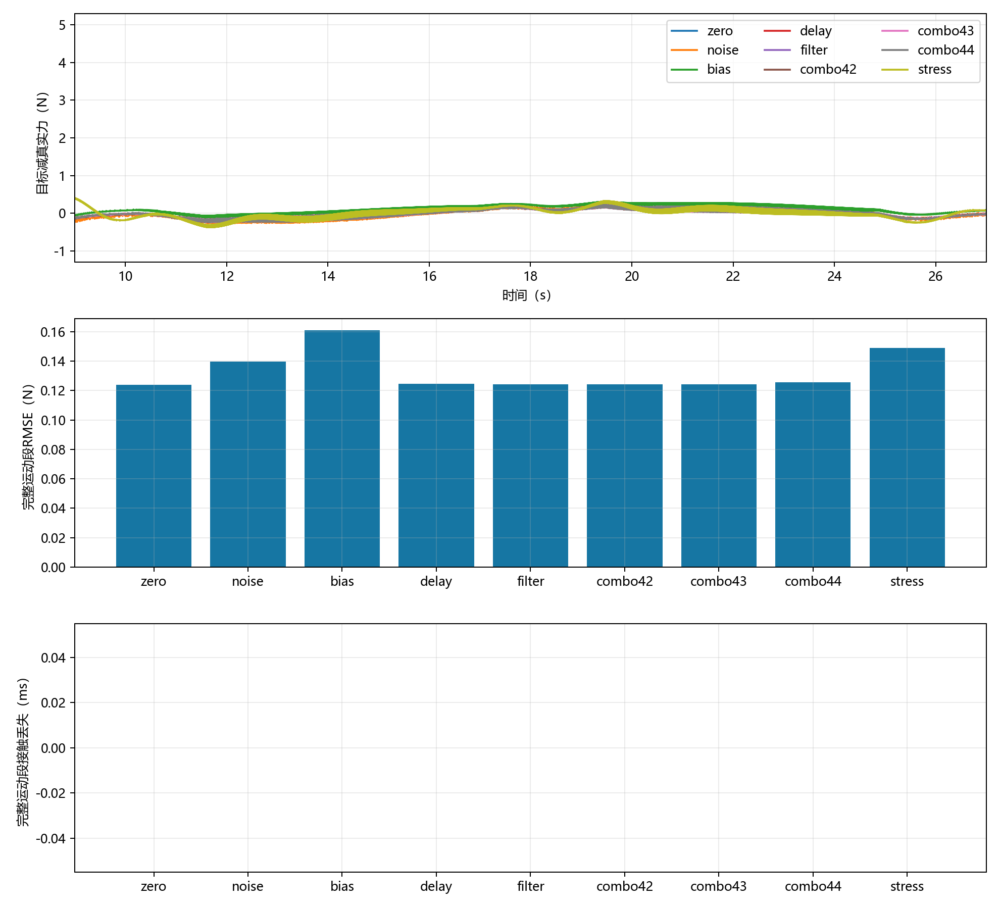

# C1固定PI九工况测量扰动实测

## TASK

在已通过的原接触模型、5 N、10 mm往返、8秒单程基线上，逐项加入噪声、偏置、延迟、低通，再做三种子组合和大延迟工况。复用原测量模型、`m1_sensor_study.cases()`及`c1_wipe.run`，不改控制器、物理循环、增益、限幅、场景或验收阈值。

新增`experiments/c1_sensor_study.py`、`tests/test_c1_sensor_study.py`和测量实验文档，更新README、接口及运行/测试说明。验收依据仍为原C1任务摘要；真实力指标单独报告，不能把批量命令完成当成全部通过。

## TASK_RESULT

实际环境：Windows、Python 3.12.14、MuJoCo 3.3.7、NumPy 2.2.6、pandas 2.2.3、Matplotlib 3.10.3，使用已有虚拟环境。运行时父提交`19af7837d27e2fd22bc99d71b9437f4545ae44ad`，新增入口与测试的实际源码SHA256见[verification.json](verification.json)；不能只用父提交号代替本次源码。

| 实际命令 | 实际结果 |
|---|---|
| `python -m pytest tests/test_c1_sensor_study.py -q` | 3 PASS，1.89秒 |
| `python -m experiments.c1_sensor_study` | 9次完整MuJoCo仿真，9/9通过原任务；均有完整16000个运动样本 |
| `python -m pytest tests -q --basetemp=t_all` | 77 PASS，14项依赖弃用警告，103.04秒 |
| 逐周期重构测量链与场景/增益核对 | PASS；9组场景摘要相同，测量重构最大差1.78e-15 N |
| 真机、真实传感器与交互窗口人工检查 | 未验证 |

本轮完整测试仍包含原3秒C1预期失败测试。新增3项测试分别覆盖完整运动段边界/接触丢失区间、提前终止不生成完整指标、完整运动段与后续末态失败的区别；9次真实实验不混算为9个新测试。

## 真实结果

以下统计取物理日志`[10,26)`秒的真实接触力，目标减真值为误差。

| 工况 | 运动力RMSE / N | 平均力误差 / N | 运动峰值力 / N | 接触丢失 / ms | 原任务 |
|---|---:|---:|---:|---:|---|
| 无扰动 | 0.124041 | 0.003340 | 5.229587 | 0 | PASS |
| 噪声0.05 N | 0.139614 | 0.001854 | 5.272448 | 0 | PASS |
| 偏置+0.1 N | 0.160878 | 0.103219 | 5.127138 | 0 | PASS |
| 延迟4步 / 20 ms | 0.124520 | 0.003329 | 5.232177 | 0 | PASS |
| 低通20 Hz | 0.124233 | 0.003337 | 5.230611 | 0 | PASS |
| 组合种子42 | 0.124172 | 0.003123 | 5.237975 | 0 | PASS |
| 组合种子43 | 0.124087 | 0.002976 | 5.236517 | 0 | PASS |
| 组合种子44 | 0.125667 | 0.003277 | 5.236993 | 0 | PASS |
| 延迟100步 / 500 ms | 0.148830 | -0.001894 | 5.373379 | 0 | PASS |

组合条件为噪声0.05 N、延迟2步（10 ms）、20 Hz低通。三个种子均完整运行且任务通过，运动RMSE均值0.124641757 N、样本标准差0.000888590 N。只有3个种子，不作统计安全保证。完整参数见[study_config.json](study_config.json)，完整指标见[comparison.csv](comparison.csv)，组合统计见[study_summary.json](study_summary.json)。



## 结果解释与核对

**9/9只代表原C1任务验收通过。** 原C1检查连续接触、实际往返和基础限制，没有运动段力RMSE门槛；不能声称上表满足某个未定义的力精度要求。各组保持连续接触不代表噪声、偏置或延迟没有影响。

偏置工况在运动段控制采样点上的平均测量力约4.995676 N，平均真值约4.895676 N，说明测量看似接近5 N时，真实力仍有偏差。这两个均值按控制采样计算，与上表每1 ms物理采样的平均误差对应不同采样集，不能直接互换。

500 ms延迟工况本次没有丢失接触，但RMSE高于无扰动。这只对应当前低速、目标和模型，没有找到延迟稳定边界，也没有证明500 ms是安全延迟上限。所有参数均为仿真假设，没有硬件标定。

已完成以下实际数据核对：

- 每组展开配置仅改变`sensor_*`字段，PI算法固定为fixed；接触模型和所有增益/限幅沿用基线。
- 9组派生场景SHA256一致；无扰动组的`contact_force.csv`与上一阶段8秒基线逐值一致。
- 从每个控制时刻的物理真值重新执行延迟、偏置/噪声和低通；全部48600个控制周期的测量值与记录相符，最大差1.78e-15 N，源时间戳一致。
- 控制器的`measured_force_n`等于滤波测量，Kp/Ki保持固定值，关节参考变化率未超出原限制。

## 原始数据与失败材料

本轮没有新增实际FAIL，全部9组原始数据均保存。程序仍保留失败摘要、数据与异常；提前终止时不会填造完整段指标。既有[原3秒反例与24次失败Debug材料](../c1-speed-matched-2026-10-25/README.md)继续保留，不因本轮通过而删除、覆盖或改写。

| 文件 | 内容 |
|---|---|
| `raw_data_01.zip`至`raw_data_04.zip` | 全部9次运行的配置、真实力、控制、关节状态、原始接触点、场景、摘要、日志与曲线 |
| `verification_logs.zip` | 实际批量日志、完整测试输出及本次测量重构/归档脚本 |
| `manifest.json` | 每个原始成员的位置、大小、SHA256，以及各压缩包摘要 |
| `verification.json` | 环境、源码摘要、场景一致性、测量重构与适用边界 |
| 汇总CSV/JSON和PNG | 可直接查看的条件、指标和曲线 |

归档约90 MB，各卷最大约24.4 MB。为减少重复，不重复归档大体积CSV的中文展示副本和可重建的`tracking.csv`。全部分卷解压到同一目录；单次运行可能跨卷，使用`manifest.json`定位。`Get-FileHash 文件路径 -Algorithm SHA256`可核对归档完整性。

## 复现与下一步

从仓库根目录、使用已有完整Python依赖环境：

```powershell
python -m experiments.c1_sensor_study
python -m pytest tests -q --basetemp=t_all
```

程序新建结果目录，不覆盖此前运行；运行pytest前先保存临时目录中需要的数据。入口、时间窗、字段单位和提前终止处理见[测量实验说明](../../c1_sensor_study.md)。归档中的校验脚本依赖本机原结果目录布局，是本次交付的核验记录；标准复现实验使用上述模块入口。

本轮固定PI、单一目标和原模型的九工况实验已完成。下一步最小任务可选择在同一8秒C1条件下做固定/在线模糊PI配对对照；不能把本报告的固定PI结果直接当作模糊控制性能。原3秒问题仍为失败反例，真机与更广泛条件均未验收。
