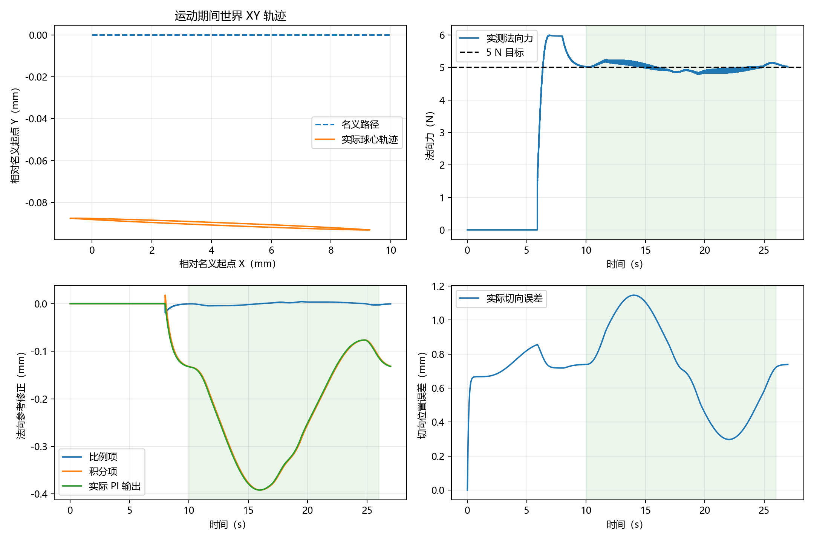
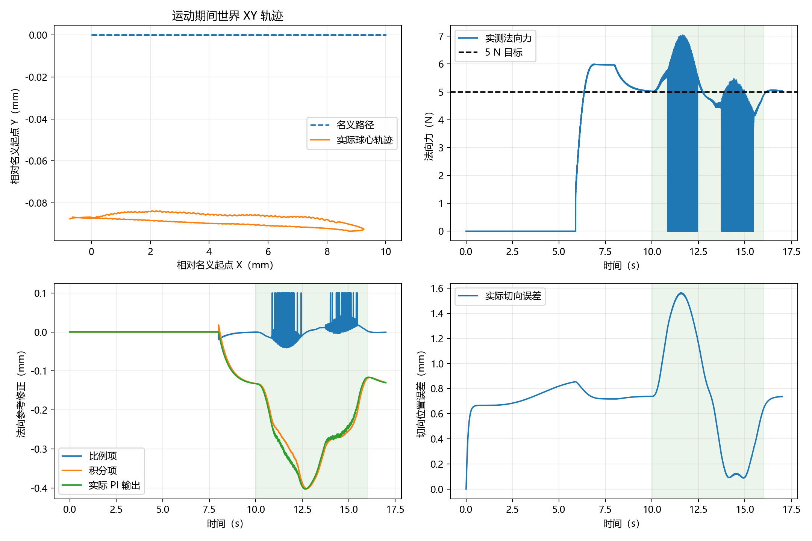
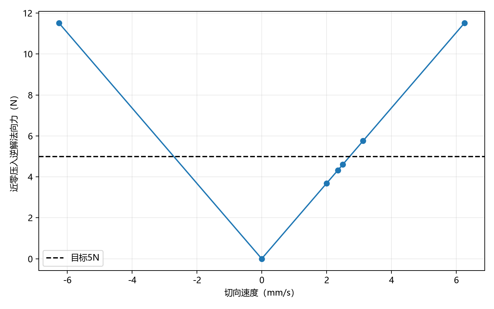

# C1原模型速度匹配与Debug证据

## TASK

目标：在原C1失败基础上定位滑动接触问题，保留失败材料，形成可复现的主验收基线。已验证基础为固定PI、真实反馈链与原3秒任务失败。最小修改是按用户选择保留5 N与原接触模型，将主任务单程时间改为8秒，同时保留原3秒配置；增加离线诊断与明确的负向回归，不改PI控制器和物理循环。

涉及`configs/c1_wipe*.json`、`experiments/c1_contact_feasibility.py`、两项测试文件及说明文档。验收仍使用原连续接触、端点、实际往返与命令限速条件。两配置展开后仅实验名称、单程时间和总时长不同，见[核对记录](verification.json)。

## TASK_RESULT

实际运行于Windows、Python 3.12.14、MuJoCo 3.3.7，NumPy 2.2.6、pandas 2.2.3、Matplotlib 3.10.3。使用已有虚拟环境，没有安装新的MuJoCo。运行时父提交为`69f3336043e27998fb77ffe48dcf5e529b582903`，当前源码哈希记录于`verification.json`；父提交号不是本次源码全部内容的标识。

| 实际运行 | 判定 | 结果 |
|---|---|---|
| `python -m experiments.c1_wipe` | PASS | 原接触模型、5 N、10 mm、8秒单程，连续接触与往返验收通过 |
| 原3秒配置的真实MuJoCo负向回归 | 实验FAIL，负向测试PASS | 抛出验收异常，保存真实失败数据 |
| `python -m experiments.c1_contact_feasibility` | 诊断PASS | 35组快照逆/正向回代与执行器范围检查通过 |
| `python -m pytest tests -q --basetemp=t_all` | 74 PASS | 耗时100.35秒，14项依赖弃用警告；其中包括原3秒预期失败测试 |
| 真机与图形窗口人工检查 | 未验证 | 仅无窗口数值仿真 |

完整测试后只对诊断图的速度轴排序，数值算法不变；最终诊断入口已重新实际运行。测试与CLI的8秒`contact_force.csv`逐值一致，属于同初态确定性重复，不能当作随机鲁棒性统计。

## 真实闭环结果

统计使用运动段每1 ms的真实接触力，不使用平滑测量替代。

| 指标 | 原3秒单程反例 | 8秒单程主基线 |
|---|---:|---:|
| 运动区间 / s | 10–16 | 10–26 |
| 运动样本数 | 6000 | 16000 |
| 名义峰值速度 / mm/s | 6.25 | 2.34375 |
| 连续接触比例 | 95.3333% | 100% |
| 运动法向力RMSE / N | 1.333269 | 0.124041 |
| 运动峰值法向力 / N | 见原始指标 | 5.229587 |
| 实际去程 / mm | 9.925279 | 10.025828 |
| 实际返回 / mm | 9.823023 | 10.008039 |
| 最终任务判定 | FAIL | PASS |

8秒主基线最大切向误差1.146232 mm，去程/返回端点误差0.714023/0.721305 mm，均沿用原阈值。完整数字见[成败对照](comparison.csv)。总仿真峰值5.996564 N包含接近阶段，与表中运动段峰值不同。





## 局部速度诊断

原接触模型的局部零关节加速度快照，在10纳米几何压入处：

| 切向速度 / mm/s | 逆解法向力 / N |
|---:|---:|
| 0 | 0.002182 |
| 2 | 3.686588 |
| 2.34375 | 4.319939 |
| 2.5 | 4.607826 |
| 3.125 | 5.759373 |
| 6.25 | 11.517110 |

35组快照中，正逆法向力最大差1.76e-12 N，正向加速度范数最大3.02e-12，七轴额外广义力为零，执行器最小力矩余量8.053186 Nm，位置命令均在范围内。手指残差单独补齐。两点近似估算局部5 N临界速度约2.713 mm/s、10 mm五次曲线单程时间约6.912秒。

这些是局部平稳条件的有限扫描，不是全轨迹可行性、全局最优速度或闭环稳定性证明；8秒基线的通过来自实际闭环运行。方法和适用限制见[诊断说明](../../c1_contact_feasibility.md)，完整快照见[CSV](force_envelope.csv)。



## 失败案例作为Debug学习材料

原3秒失败与后续通过数据并列保留。另外归档24次失败调试运行，完整索引见[failure_inventory.json](failure_inventory.json)。这些是不同诊断分支，不是24次独立重复实验，不能用来计算统计失败率。

| 诊断分支 | 真实结果 | 可以学到什么 |
|---|---|---|
| 冻结运动段PI | 接触保持97.2167%，FAIL | 问题不只表现为持续PI更新；冻结也不是合格控制方案 |
| 2 Hz测量低通 | 95.4667%，FAIL | 平滑反馈没有恢复连续接触 |
| Ki降至0.00003 | 96.9833%，FAIL | 降低积分增益没有解决原任务 |
| 单程6秒 | 99.5833%，FAIL | 接近100%仍不满足连续接触要求，不放宽阈值 |
| RK4积分 | 末态关节速度超限，FAIL | 运行到结束不等于任务通过，必须保留最终检查 |
| Euler积分 | 0.956秒切向误差超限，提前FAIL | 只分析已有样本，不补造后续运动段指标 |

其余分支包括控制周期、关节参考变化率、摩擦、接触参数、模糊增益、法向阻尼、插值、前馈和切向力诊断。每条分支保留原始配置、接触真值、控制命令、关节反馈、原始接触点、摘要、已有曲线与运行日志；提前失败导致某些最终文件不存在时，按实际产出保存。

建议按以下顺序学习：

1. 先复现原3秒失败，定位`summary.json`的最终判定及`c1_metrics.json`的接触比例。
2. 对齐`contact_force.csv`与`control.csv`时间戳，查看抬离时刻的真实力、目标位置和PI修正。
3. 对照冻结PI、降低Ki、滤波分支，明确“指标有改善”与“满足验收”的差别。
4. 查看局部速度诊断，再比较6秒失败与8秒成功，写出适用条件和仍未证明的部分。

## 归档和复现

| 文件 | 内容 |
|---|---|
| `baseline_raw_01.zip` | 8秒CLI、原3秒负向回归和最终局部诊断原始结果 |
| `debug_raw_01.zip`至`debug_raw_06.zip` | 24次失败调试运行，按文件体积分卷 |
| `debug_methods_and_logs.zip` | 实际诊断脚本、各分支比较输出、逆解扫描、测试与CLI日志 |
| `manifest.json` | 每个压缩包与原始成员的SHA256、大小、成员路径 |
| `verification.json` | 运行版本、源码哈希、配置差异、测试结果与限制 |
| `comparison.csv`、`force_envelope.csv`、三张PNG | 可直接查看的指标与曲线 |

归档合计约157 MB，单个最大约24 MB。为减少重复，不归档中文展示副本与可由接触/控制CSV重建的`tracking.csv`；原始英文字段CSV和中文指标JSON保留。把所有需要的分卷解压到同一个目录，按`manifest.json`定位某次运行的数据；某次运行的文件可能跨卷。可用`Get-FileHash 文件路径 -Algorithm SHA256`核对归档。

当前代码下复现：

```powershell
python -m experiments.c1_wipe
python -m experiments.c1_wipe --config configs/c1_wipe_legacy_3s.json
python -m experiments.c1_contact_feasibility
```

第二条应失败。调试脚本不是正式控制入口：要复现历史分支，应在独立工作副本检出父提交`69f3336`（其默认C1仍为3秒），将归档中的`audit/`置于该副本的`audit/`目录，使用仓库根目录作为当前目录，并将根目录加入`PYTHONPATH`，例如：

```powershell
$env:PYTHONPATH = (Get-Location).Path
python audit/c1_feedback_isolation.py
python audit/c1_integration_probe.py
```

它们会在当前进程替换部分诊断函数或场景设置，必须作为独立进程运行；不能把旧脚本直接作用于当前8秒默认配置后声称复现了旧3秒数据。参数扫描脚本和实际配置共同解释各分支，冻结/前馈等特殊分支需要相应脚本，不能只靠`config.json`复现。

## 问题与下一步

本次交付完成所选8秒C1主基线与失败案例整理。原3秒要求仍FAIL，其完整动态可行性尚未证明。噪声/延迟下的C1以及更多目标、独立多点调参消融仍未验收；不要将当前结果扩大为任意接触条件或真机通过。下一步最小实验可在已通过的8秒基线上单独加入测量扰动，再保存新的成功和失败记录。
