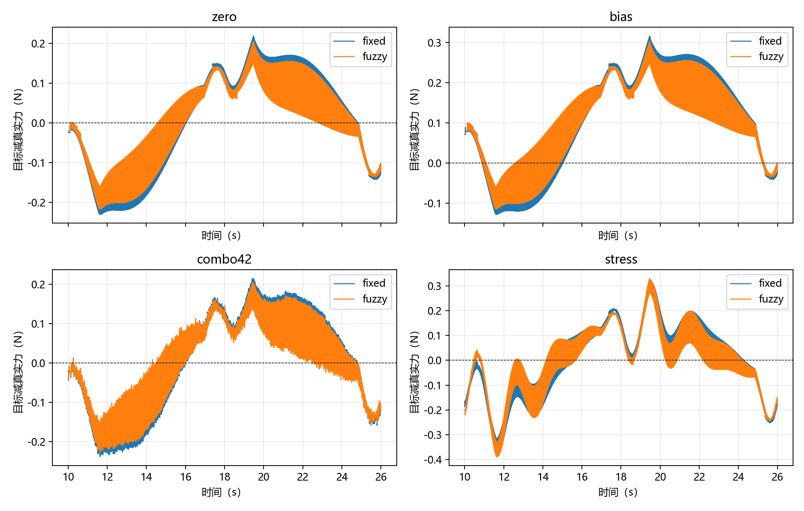
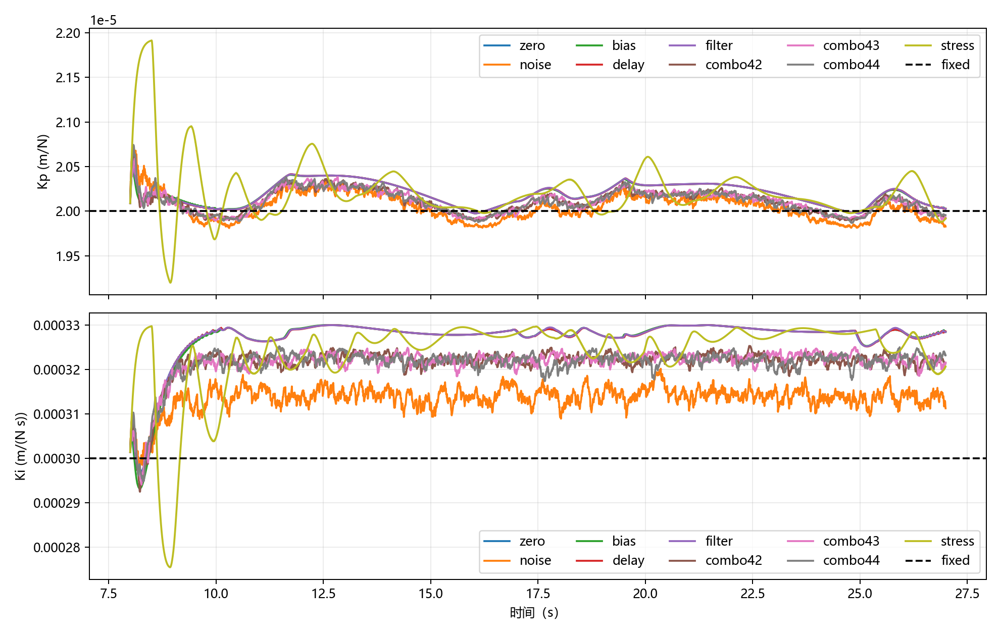

# 在线模糊PI静态复验与C1运动配对实测

## TASK

复验已有在线模糊PI，并在用户选定的原接触模型、5 N、10 mm往返、8秒单程C1基线上补充九工况固定/模糊配对。复用已有控制器、传感器、物理循环与原验收阈值；只新增实验组织入口。保存所有结果、失败输出和实际生效增益。

## TASK_RESULT

实际运行环境：Windows 11、Python 3.12.14、MuJoCo 3.3.7、NumPy 2.2.6、pandas 2.2.3、Matplotlib 3.10.3。使用已有解释器，无新增安装。运行父提交为 `36c090550bb1f7c4c9f7274faff08f1425d96a0f`；C1新增脚本运行时尚未提交，精确源码见归档及 `verification.json`，不能只用父提交重建本轮。

| 实际命令（从仓库根运行） | 实际结果 |
|---|---|
| `python -m pytest tests/test_fuzzy_pi.py -q --basetemp=results/V20261028/t` | 9 PASS / 1 FAIL；模型加载失败，仿真时间0秒 |
| `python -m pytest tests/test_fuzzy_pi.py -q --basetemp=t_v28` | 10 PASS，14项依赖弃用警告，5.51秒 |
| `python -m pytest tests/test_c1_sensor_study.py -q -p no:cacheprovider` | 3 PASS，0.41秒 |
| `python -m experiments.m1_fuzzy_comparison --output results/V20261028/M` | 12/12通过原M1验收，6组模糊增益在线变化 |
| `python -m experiments.c1_fuzzy_comparison --output results/V20261028/C` | 18/18通过原C1任务，完整运动段18/18，9组模糊增益在线变化 |
| `python docs/evidence/fuzzy-validation-2026-10-28/verify_results.py` | 30次控制/测量重放、15对公平性及21项历史指标复现 PASS；需保留本轮results目录 |

本轮相关测试最终13 PASS；首次路径失败单独保留，不能删去或混算为控制失败。没有重跑完整77项回归；77 PASS属于上一轮历史记录。

实际改动：新增 `experiments/c1_fuzzy_comparison.py`，补齐README文件说明和算法、接口、运行、测试文档，保存本报告及数据。控制器、模糊规则、基准增益、限幅、场景与验收阈值未修改；关键控制源码已与HEAD逐文件核对。

## M1静态接触复验

物理步长1 ms、控制周期5 ms，8秒接管，12秒结束；稳定时间从接管开始计，需最终进入±0.1 N带并持续至少0.5秒。RMSE来自真实物理接触力，不使用滤波测量值替代。

| 工况 | 固定/模糊末秒RMSE（N） | 固定/模糊全控制段RMSE（N） | 固定/模糊稳定时间（s） |
|---|---:|---:|---:|
| zero | 0.003493 / 0.001229 | 0.246373 / 0.245436 | 1.221 / 1.166 |
| combo42 | 0.006421 / 0.006715 | 0.242483 / 0.241447 | 1.246 / 1.229 |
| combo43 | 0.006148 / 0.005966 | 0.243074 / 0.242007 | 1.141 / 1.169 |
| combo44 | 0.006603 / 0.006369 | 0.241888 / 0.240481 | 1.196 / 1.183 |
| contact_soft | 0.003046 / 0.000661 | 0.191391 / 0.189009 | 1.101 / 1.076 |
| contact_hard | 0.002588 / 0.000510 | 0.279701 / 0.280416 | 1.276 / 1.261 |

六对接管后的正向峰值偏差两种算法相同：原模型0.964951 N、soft参数0.733029 N、hard参数1.118929 N。该峰值出现在接管初始，不应归为在线调节降低了超调。contact_solref变化未标定成物理刚度N/m，不能称完成多刚度验证。

不利结果：combo42模糊末秒RMSE较大；combo43模糊稳定时间较长；contact_hard模糊全控制段RMSE较大。静态12组末秒指标均复现历史结果，误差小于1e-12 N。

完整统计见 [M1表](m_comparison.csv)，曲线见 [M1实际增益](m_online_gains.png) 与 [M1力误差](m_force_errors.png)。

## C1运动接触配对

统一使用原接触模型、5 N、10 mm单程、8秒单程；运动区间 `[10,26)` 秒，每次16000个物理样本，27秒结束。原C1验收关注基础限制、连续接触和实际往返，没有运动段力RMSE门槛。以下RMSE单独评价，不能把任务PASS当成力精度达标。

九工况：无扰动；仅0.05 N标准差噪声；仅+0.1 N偏置；仅20 ms延迟；仅20 Hz低通；噪声0.05 N＋延迟10 ms＋20 Hz低通的42/43/44三种子；仅500 ms延迟压力工况。所有条件均为仿真假设，不是传感器标定或容许延迟上限。

| 工况 | 固定PI运动RMSE（N） | 模糊PI运动RMSE（N） | RMSE下降 | 固定/模糊接触丢失（ms） |
|---|---:|---:|---:|---:|
| zero | 0.124041 | 0.113359 | 8.61% | 0 / 0 |
| noise | 0.139614 | 0.134411 | 3.73% | 0 / 0 |
| bias | 0.160878 | 0.152496 | 5.21% | 0 / 0 |
| delay | 0.124520 | 0.113842 | 8.58% | 0 / 0 |
| filter | 0.124233 | 0.113549 | 8.60% | 0 / 0 |
| combo42 | 0.124172 | 0.115705 | 6.82% | 0 / 0 |
| combo43 | 0.124087 | 0.115598 | 6.84% | 0 / 0 |
| combo44 | 0.125667 | 0.117212 | 6.73% | 0 / 0 |
| stress | 0.148830 | 0.143276 | 3.73% | 0 / 0 |

三种子运动RMSE均值±样本标准差：固定 `0.124642 ± 0.000889 N`，模糊 `0.116172 ± 0.000903 N`，各n=3。九组运动RMSE均较低，仅支持这批条件的局部结论。

不利结果仍保留：500 ms延迟时，模糊正向峰值偏差0.388286 N，高于固定0.373379 N，尽管RMSE较低。+0.1 N偏置时，两者平均真实力误差仍约+0.103 N；在线增益调节没有消除传感器偏置。

`c_motion_detail.png`从归档CSV先截取运动窗口再自动缩放纵轴。原入口的 `c_force_errors.png` 保留全部时间段的纵轴范围，仅限制横轴显示，可能掩盖小幅差异；不能据此判定两条曲线完全相同。完整表见 [C1统计](c_comparison.csv)、[三种子统计](c_combo_statistics.csv)、[RMSE变化](c_rmse_change.csv)。

## 独立核对

30次仿真均重构完整传感器链、对齐物理真值与控制采样，测量重构最大差 `1.78e-15 N`。从实际测量输入重放固定/模糊PI，Kp/Ki、比例、积分和输出修正五字段最大差 `1e-16`（各字段保留原单位）。

15对均只有pi_algorithm不同，场景与模型资源摘要相同、随机噪声序列相同、接管前真实力逐值一致。核对实际增益范围、比例项、积分/输出/变化率限制和关节参考速率。15组模糊实际Kp、Ki都在线变化。9组固定C1运动RMSE复现历史基线。证据见 [verification.json](verification.json)。

## Debug材料与数据恢复

首次测试使用过深的临时目录，MuJoCo报告无法打开 `link5_collision_0.obj`；模型加载尚未成功，失败时刻0秒。缩短目录为t_v28后10项原测试全部通过，未修改模型或放宽断言。初始summary、场景和run.log保留在归档逻辑目录 `debug_initial_model_load/`；完整测试异常输出在 `provenance/fuzzy_tests.log`，重跑输出在 `provenance/fuzzy_tests_short_path.log`。

原3秒C1接触失败及此前Debug材料继续保留，详见 [原C1失败记录](../c1-speed-matched-2026-10-25/README.md)。本轮18次通过不能覆盖原3秒失败。

[manifest.json](manifest.json)列出464个逻辑成员及archive、member、SHA256、字节数。6个新ZIP合计119489033字节，76个逐字节相同的历史CSV引用旧归档，避免重复保存。所有新旧引用成员均完成SHA256和ZIP CRC核验。解包时必须按manifest从各archive取member并写入对应逻辑路径；`../`表示引用历史文件，不可仅解压本目录新ZIP就认为数据齐全。

`M/`、`C/`逻辑目录保留contact_force/control/joint_state/raw_contacts四类原始CSV、配置、最终摘要、场景、模型/资源摘要及运行日志；成功和失败都不筛选。`source/`保存本轮源码和配置快照，`provenance/`保存实际命令输出和核对/打包脚本。原始本轮工作目录仍在 `results/V20261028/`，被.gitignore排除；归档不依赖这些忽略文件继续存在。

`verify_results.py`从本轮results目录重放测量和控制、检查源码及历史指标；`package_results.py`为本轮Windows审计路径的打包脚本快照，不是控制入口；`make_report.py`可在仓库根运行，从manifest所列归档和汇总重建本报告及细节图。

## 验证边界与本阶段收口

本轮没有新增控制算法或重新整定规则，没有重跑完整测试集，没有真实传感器、真机或交互窗口验证，也没有用标定N/m刚度完成系统鲁棒性证明。

按用户确认的最小开发范围，本阶段以固定/模糊PI同条件对照显示局部性能提升为验收目标，现有证据已满足；取消后续固定Ki消融，不继续扩大算法、目标或实验范围。只处理影响运行、复现和交付的实际问题。该收口不改变原始数据、失败记录或结论边界。
